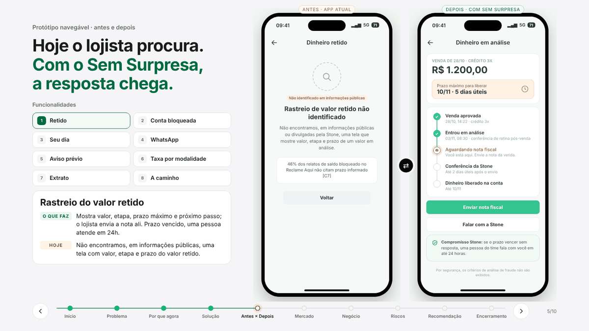

# Sem Surpresa: um case de estratégia feito em 6 dias com IA

> Projeto independente, sem vínculo com a Stone. Usa só dados públicos e pesquisa própria. Os nomes dos estabelecimentos entrevistados foram anonimizados.

## O que é

Case do processo seletivo Recruta Stone 2027. O desafio pedia entender as dores de um segmento de clientes da Stone e propor uma solução alinhada à missão da empresa, com relatório de até 5 páginas e apresentação de 5 minutos.

A proposta, **Sem Surpresa**, parte de uma promessa ao lojista: *você sabe quanto, onde e até quando*. Ela funciona como o rastreio de uma encomenda, só que para o dinheiro:

- quando uma venda ou conta entra em análise, o lojista vê o valor, a etapa, o prazo máximo e o próximo passo;
- um resumo diário mostra o que entrou, o que custou e o que está a caminho;
- nenhuma mudança de taxa ou prazo passa a valer sem aviso prévio, com o impacto em reais.

O pedido final foi um piloto com grupo de controle, começando manual, com 20 a 30 clientes nos 90 primeiros dias de relação.

## O processo em números

| | |
|---|---|
| Duração | cerca de 6 dias (28/10 a 02/11/2026) |
| Entrevistas presenciais | 12 lojistas em Rio Claro, Amparo e Campinas |
| Reclame Aqui | 57 reclamações recentes e 50 relatos de saldo bloqueado, classificados à mão |
| Dados da empresa | planilha de resultados do 2T26 da StoneCo |
| Entregas | relatório, anexo de cálculos, pesquisa de campo, planilha de dados e apresentação interativa em HTML com protótipo navegável |

## Como foi feito

Usei o Claude como parceiro de análise e produção, e outras IAs como revisoras independentes.

**O que ficou comigo:** as entrevistas, o levantamento do Reclame Aqui e todas as decisões sobre a proposta e a narrativa.

**O que ficou com a IA:** organizar as evidências, propor e reposicionar a solução, escrever e revisar o relatório, montar os cálculos e a apresentação.

### Trajetória

1. **Primeira leitura do Reclame Aqui.** Surge uma ideia inicial, ainda pouco estruturada: o *Radar de Caixa*, uma previsão de caixa para o lojista.
2. **Quatro primeiras entrevistas.** Os clientes descrevem a Stone pelo que *não* acontece: dinheiro que não atrasa, máquina que não falha. Quase ninguém relata problema, e isso vira a pergunta da pesquisa: onde está a dor?
3. **Levantamento manual do Reclame Aqui.** Dinheiro bloqueado ou retido é o tema de 11 das 18 reclamações de lojistas na amostra. Em 46% dos relatos de bloqueio, não aparece nenhum prazo informado.
4. **Mais oito entrevistas**, incluindo ex-clientes e clientes de outras marcas.
5. **Nasce o Sem Surpresa.** A dor não é prever o caixa, e sim não saber o que acontece com o dinheiro.

### Onde a IA errou e como corrigi

O padrão mais comum: quando o prompt deixava espaço, a IA escolhia a versão mais forte da história. As correções mais importantes deixaram a proposta mais precisa, mesmo quando isso a tornava mais modesta.

| O que aconteceu | Como corrigi |
|---|---|
| A IA deduziu a ordem da pesquisa pelos horários dos arquivos e escreveu que o Reclame Aqui veio antes das entrevistas | Informei a ordem real e pedi a correção em todos os materiais. Fatos sobre o meu processo precisam vir de mim. |
| A redução de churn aparecia como ganho principal, sem conta | Pedi a conta com premissas. O valor era pequeno, e o caso de negócio passou a ter premissas declaradas, dimensionamento em faixa e limites. |
| Percentuais com o denominador trocado | Passei a exigir o *n* ao lado de cada percentual ("11 de 18") e a dizer o que cada número conta. |

### Técnicas que mais funcionaram

- **Avaliação antes de execução:** "avalie o que é importante" em vez de "aplique essas críticas".
- **Permissão para descartar a ideia:** pedir uma solução "ajustando a anterior ou completamente nova".
- **Restrição de fonte:** "use apenas os fatos abaixo, sem inventar datas, números ou falas".
- **Revisão cruzada:** críticas de outras IAs coladas no chat para serem avaliadas antes de qualquer mudança.
- **Rastreabilidade:** cada número do relatório leva a uma seção do anexo de cálculos (C1 a C9), com a conta e a fonte.

Todas as 14 etapas, as técnicas e os modelos de prompt reutilizáveis estão em [`processo/processo-e-prompts.md`](processo/processo-e-prompts.md).

## Arquivos

| Arquivo | Conteúdo |
|---|---|
| [`entrega/relatorio.pdf`](entrega/relatorio.pdf) | Relatório de 5 páginas |
| [`entrega/calculos.pdf`](entrega/calculos.pdf) | A conta de cada número, com fonte |
| [`entrega/pesquisa-de-campo.pdf`](entrega/pesquisa-de-campo.pdf) | As 12 entrevistas (anonimizadas) |
| [`entrega/apresentacao.html`](entrega/apresentacao.html) | Apresentação interativa. No slide 5, um protótipo navegável mostra lado a lado o app como é hoje e o app com o Sem Surpresa, sincronizados |
| [`dados/reclame-aqui.xlsx`](dados/reclame-aqui.xlsx) | Classificação das reclamações, com metodologia |
| [`processo/processo-e-prompts.md`](processo/processo-e-prompts.md) | Como o case foi construído com IA |

Para ver a apresentação, baixe `apresentacao.html` e abra no navegador. Use as setas do teclado para trocar de slide.

## Limites

- As premissas de retenção e de impacto financeiro são hipóteses para o piloto testar, não resultados.
- O Reclame Aqui mede gravidade, não frequência.
- As entrevistas são qualitativas e regionais.
- O protótipo é conceitual. A tela "app atual" é uma recriação a partir de material público, não o app oficial, e todos os dados são fictícios.
